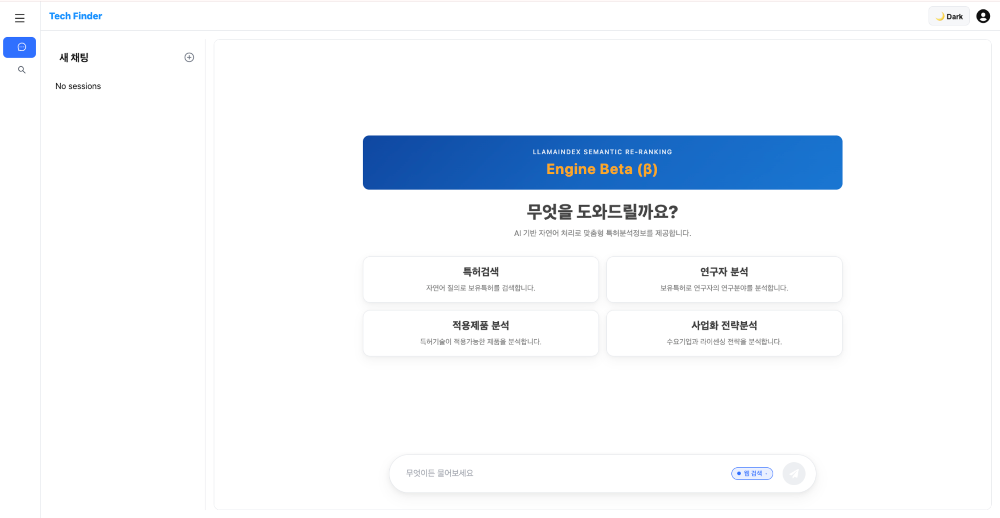
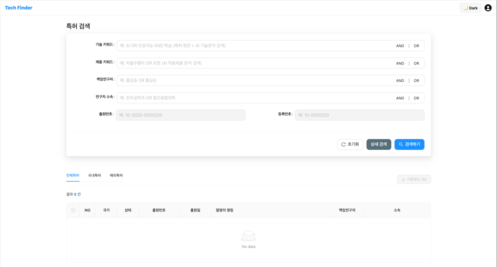
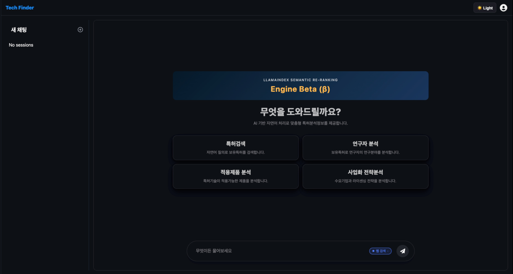

# AI INNOTASK — 특허 검색 및 분석 플랫폼

AI 기반 자연어 처리와 특허 검색 기술을 활용해 특허 정보를 탐색하고, 연구·기술 사업화에 필요한 인사이트를 얻을 수 있는 플랫폼입니다.

## 서비스 화면

### 1. 서비스 소개


### 2. AI 챗봇 및 분석 메뉴
자연어 질의를 바탕으로 특허 검색과 연구자·적용 제품·사업화 전략 분석 기능에 접근할 수 있습니다.



### 3. 특허 상세 검색
기술 및 제품 키워드, 책임연구자, 연구자 소속, 출원번호, 등록번호 등을 기준으로 특허를 검색할 수 있으며, AND/OR 조건을 활용할 수 있습니다.



### 4. 다크 모드
라이트/다크 테마를 지원해 사용 환경에 맞춰 화면을 전환할 수 있습니다.



## 주요 기능

- **고급 특허 검색**: 기술 키워드, 제품 키워드, 명세서 및 청구범위 검색
- **AND/OR 검색 조건**: 여러 조건을 조합한 검색
- **특허 정보 조회**: 출원번호, 공개번호, 등록번호, IPC/CPC 코드 등 확인
- **특허 문서 열람**: 특허 공보 PDF 조회
- **AI 기반 분석 진입점**: 특허 검색, 연구자 분석, 적용제품 분석, 사업화 전략 분석
- **라이트/다크 모드**: 테마 전환을 지원하는 사용자 인터페이스
- **반응형 화면 구성**: 사이드바 및 콘텐츠 영역 기반의 UI

## Repository layout

- Frontend: `frontend/` (React + Vite) — see `frontend/README.md`
- Backend: `backend/` (FastAPI) — see `backend/README.md`

## 기술 스택

### Frontend
- **React 19.2.0**: UI 라이브러리
- **TypeScript**: 타입 안정성
- **Vite 7.2.4**: 빌드 도구 및 개발 서버
- **Ant Design 6.1.1**: UI 컴포넌트 라이브러리
- **React Router 7.10.1**: 라우팅
- **Styled Components 6.1.19**: CSS-in-JS 스타일링
- **Axios 1.13.2**: HTTP 클라이언트

### Backend
- **FastAPI**: 고성능 Python 웹 프레임워크
- **MongoDB**: NoSQL 데이터베이스 (Motor 비동기 드라이버)
- **Elasticsearch**: 검색 엔진
- **Python 3.12+**: 백엔드 언어

### 개발 도구
- **ESLint**: 코드 품질 관리
- **TypeScript ESLint**: TypeScript 린팅
- **Git**: 버전 관리

## PDF 파일 관리

### 중요: PDF 파일은 Git에 포함되지 않습니다

- PDF 파일들은 `backend/storage/pdfs/` 디렉토리에 저장됩니다 (약 4.4GB)
- Git에는 코드만 포함되며, PDF 파일들은 `.gitignore`에 의해 제외됩니다
- 각 환경(개발/프로덕션)에서 PDF 파일들을 별도로 관리해야 합니다

### PDF 파일 설정 방법

1. **로컬 개발 환경**
   ```bash
   mkdir -p backend/storage/pdfs
   # PDF 파일들을 backend/storage/pdfs/ 디렉토리에 배치
   ```

2. **프로덕션 환경**
   - 서버에 `backend/storage/pdfs/` 디렉토리 생성
   - PDF 파일들을 서버에 직접 복사 또는 rsync 사용
   - FastAPI가 `/static/pdfs/` 경로로 제공합니다

3. **PDF 경로 업데이트**
   ```bash
   python backend/update_pdf_paths.py
   ```

### 향후 개선 방안
- 클라우드 스토리지 (AWS S3, Google Cloud Storage) 연동
- CDN을 통한 PDF 파일 제공
- Git LFS 사용 (용량 제한 고려 필요)

## 시작하기

### 필수 요구사항
- Node.js 18+
- Python 3.12+
- MongoDB
- Elasticsearch

### 설치 및 실행

1. **프론트엔드 설정**
   ```bash
   cd frontend
   npm install
   npm run dev
   ```

2. **백엔드 설정**
   ```bash
   cd backend
   pip install -r requirements.txt
   cd ..
   uvicorn backend.main:app --reload
   ```

3. **환경 변수 설정**
   - Backend: `backend/.env`에 `MONGODB_URI` 및 기타 설정 추가
   - Frontend: 필요 시 `frontend/.env.local` 사용

## Deploy on Railway (Docker)

이 저장소는 프론트엔드와 백엔드의 두 서비스로 배포하는 모노레포입니다. Railway에서 각각 별도의 서비스를 생성합니다.

### Backend service (FastAPI)
- **Builder**: Dockerfile
- **Dockerfile path**: `backend/Dockerfile`
- **Port**: Railway가 제공하는 `PORT` 환경 변수 사용
- **환경 변수**: `MONGODB_URI` (또는 `MONGO_URI`), `DB_NAME` (선택), `ELASTICSEARCH_URL`, `OPENAI_API_KEY`, `QDRANT_URL`, `QDRANT_API_KEY`, `SECRET_KEY`, `PDF_DIR` (선택)

### Frontend service (Vite)
- **Builder**: Dockerfile
- **Dockerfile path**: `frontend/Dockerfile`
- **Build arg**: `VITE_BACKEND_URL`에 백엔드 공개 URL 지정
- **Port**: Railway가 제공하는 `PORT` 환경 변수 사용

## 라이선스

이 프로젝트는 한양대학교 산학협력단에게 있습니다.

### Backend
- **FastAPI**: 고성능 Python 웹 프레임워크
- **MongoDB**: NoSQL 데이터베이스 (Motor 비동기 드라이버)
- **Elasticsearch**: 검색 엔진
- **Python 3.12+**: 백엔드 언어

### 개발 도구
- **ESLint**: 코드 품질 관리
- **TypeScript ESLint**: TypeScript 린팅
- **Git**: 버전 관리

## PDF 파일 관리

### 중요: PDF 파일은 Git에 포함되지 않습니다

- PDF 파일들은 `backend/storage/pdfs/` 디렉토리에 저장됩니다 (약 4.4GB)
- Git에는 코드만 포함되며, PDF 파일들은 `.gitignore`에 의해 제외됩니다
- 각 환경(개발/프로덕션)에서 PDF 파일을 별도로 관리해야 합니다

### PDF 파일 설정 방법

1. **로컬 개발 환경**:
   ```bash
   # backend/storage/pdfs/ 디렉토리에 PDF 파일들을 복사
   mkdir -p backend/storage/pdfs
   # PDF 파일들을 해당 디렉토리에 배치
   ```

2. **프로덕션 환경**:
   - 서버에 `backend/storage/pdfs/` 디렉토리 생성
   - PDF 파일들을 서버에 직접 복사 또는 rsync 사용
   - FastAPI가 `/static/pdfs/` 경로로 제공합니다

3. **PDF 경로 업데이트**:
   ```bash
   # MongoDB에 PDF 경로를 업데이트하는 스크립트 실행
   python backend/update_pdf_paths.py
   ```

### 향후 개선 방안

- 클라우드 스토리지 (AWS S3, Google Cloud Storage) 연동
- CDN을 통한 PDF 파일 제공
- Git LFS 사용 (용량 제한 고려 필요)

## 시작하기

### 필수 요구사항

- Node.js 18+
- Python 3.12+
- MongoDB
- Elasticsearch

### 설치 및 실행

1. **프론트엔드 설정**:
   ```bash
   cd frontend
   npm install
   npm run dev
   ```

2. **백엔드 설정**:
   ```bash
   cd backend
   pip install -r requirements.txt
   cd ..
   uvicorn backend.main:app --reload
   ```

3. **환경 변수 설정**:
   - Backend: `backend/.env`에 `MONGODB_URI` 및 기타 설정 추가
   - Frontend: 필요 시 `frontend/.env.local` 사용

## 라이선스

이 프로젝트는 한양대학교 산학협력단에게 있습니다.
